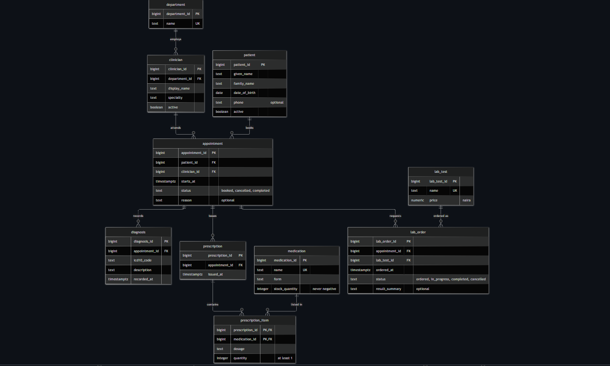

# MIT 8103 Advanced Database Systems Portfolio: The Craftsmen Clinic

**Chidubem Asogwa · 301928798**
Master of Information Technology, MIVA Open University · First Semester Continuous Assessment, 2026/2027
Individual Practical Database Portfolio (40 marks)

**Case study category:** Hospital / Clinic System
**Final summary (LMS):** [Asogwa_Chidubem_301928798_ReadMeSummary.docx](Asogwa_Chidubem_301928798_FinalSummary.pdf)

---

## Contents

1. [Case study](#case-study)
2. [The five portfolios](#the-five-portfolios)
3. [Key results](#key-results)
4. [Repository structure](#repository-structure)
5. [How to run everything](#how-to-run-everything)
6. [Evidence index](#evidence-index)
7. [How this repository meets the brief](#how-this-repository-meets-the-brief)
8. [Technologies](#technologies)
9. [AI use declaration](#ai-use-declaration)
10. [References](#references)

---

## Case study

**The Craftsmen Clinic** is a simulated outpatient clinic in Nigeria, chosen from the brief's **Hospital / Clinic System** category. I chose it because I build hospital management and doctor appointment booking systems, and wanted to understand the database underneath them. The same clinic is used in all five portfolios. All data is synthetic; no real patient data is used.

| Element | The Craftsmen Clinic |
| --- | --- |
| Nature of the business | Outpatient care across five departments (General Medicine, Dermatology, Paediatrics, Obstetrics and Gynaecology, Ear, Nose and Throat), with an in-house laboratory and pharmacy |
| Users | Receptionists, clinicians, lab scientists, pharmacists, clinic administrator |
| Major data | Patients, clinicians and departments, appointments, diagnoses, prescriptions and pharmacy stock, lab orders, detailed lab results |
| Key operations | Register patients, book appointments without double booking, record diagnoses, prescribe and dispense medicine, order lab tests and record results, retrieve a patient's full history |
| Out of scope | Inpatient functions (wards, beds, admissions) and billing |



*The appointment is the hub of the design: every diagnosis, prescription and lab order belongs to a visit, and every visit links one patient to one clinician.*

---

## The five portfolios

Each portfolio has its own README with full explanations, results and screenshots.

### [Portfolio 1: Database Design and Modelling](portfolio-1-database-design/Asogwa_Chidubem_301928798_P1_README.md)

A PostgreSQL schema of 10 tables: nine core entities and one link table (`prescription_item`) connecting prescriptions to medicines. Primary keys, foreign keys, and not-null, unique and check constraints enforce the clinic's rules, such as no double booking and no negative stock. All 12 deliberately invalid statements were rejected. A paper visit form is normalised from UNF to 3NF, and a join check proves the decomposition lost no information.

[Design](portfolio-1-database-design/Asogwa_Chidubem_301928798_P1_Design.md) · [ER diagram](portfolio-1-database-design/Asogwa_Chidubem_301928798_P1_ERDiagram.md) · [Normalisation](portfolio-1-database-design/Asogwa_Chidubem_301928798_P1_Normalisation.md) · [Schema](portfolio-1-database-design/Asogwa_Chidubem_301928798_P1_Schema.sql)

### [Portfolio 2: Query Processing and Optimisation](portfolio-2-query-optimisation/Asogwa_Chidubem_301928798_P2_README.md)

200,000 appointments and related records generated with a reproducible seed script. Four everyday clinic queries measured with `EXPLAIN (ANALYZE, BUFFERS)`, median of 7 runs, before and after indexing. Includes a composite index, a partial index, and two honest cases where an index did not help.

[Seed data](portfolio-2-query-optimisation/Asogwa_Chidubem_301928798_P2_SeedData.sql) · [Queries](portfolio-2-query-optimisation/Asogwa_Chidubem_301928798_P2_Queries.sql) · [Benchmark](portfolio-2-query-optimisation/Asogwa_Chidubem_301928798_P2_Benchmark.sql) · [Execution plans](portfolio-2-query-optimisation/plans/)

### [Portfolio 3: Transactions and Concurrency](portfolio-3-transactions-concurrency/Asogwa_Chidubem_301928798_P3_README.md)

Commit, rollback and savepoints in real clinic workflows, then five two-session scenarios run in side-by-side terminals: a lost update, two ways to prevent it (`SELECT … FOR UPDATE` and `REPEATABLE READ`), a double-booking race stopped by the Portfolio 1 constraint, and a deadlock detected by PostgreSQL.

[Commit and rollback](portfolio-3-transactions-concurrency/Asogwa_Chidubem_301928798_P3_CommitRollback.sql) · [Concurrency scenarios](portfolio-3-transactions-concurrency/Asogwa_Chidubem_301928798_P3_ConcurrencyScenarios.sql) · [Reset](portfolio-3-transactions-concurrency/Asogwa_Chidubem_301928798_P3_Reset.sql)

### [Portfolio 4: NoSQL and Advanced Data Models](portfolio-4-nosql/Asogwa_Chidubem_301928798_P4_README.md)

Detailed lab results modelled as MongoDB documents, because every test has a different structure. A `$jsonSchema` validator requires the shared fields while letting each test's results vary. Includes four queries, an aggregation, a validation test and an index, plus an honest discussion of when PostgreSQL would be the better choice.

[Lab results script](portfolio-4-nosql/Asogwa_Chidubem_301928798_P4_LabResults.js)

### [Portfolio 5: Distributed and Cloud Database Design](portfolio-5-distributed-cloud/Asogwa_Chidubem_301928798_P5_README.md)

A design discussion grounded in the earlier results: replication for PostgreSQL and MongoDB, why the clinic does not need sharding (and which shard key it would use if it did), the CAP trade-off for bookings and stock, recovery targets, and a secure cloud deployment with an architecture diagram.

---

## Key results

| Portfolio | Result |
| --- | --- |
| 1 | 10 tables; 12 of 12 invalid statements rejected; join check rebuilt the 1NF rows exactly |
| 2 | Patient history 36.1 ms → 0.16 ms (about 220× faster); lab worklist 34.7 ms → 0.11 ms (about 310× faster) with a 32 kB partial index |
| 2 | Clinician schedule needed no new index: the double-booking constraint already provided one |
| 3 | Lost update reproduced (stock 480 instead of 470, no error) and fixed two ways; double booking rejected by the unique constraint; deadlock detected and resolved |
| 4 | Six results in five different document shapes; invalid document rejected; plan changed from `COLLSCAN` (6 documents examined) to `IXSCAN` (3) |
| 5 | Sharding unnecessary: two years of appointments take 35 MB; consistency chosen over availability for bookings and stock |

---

## Repository structure

```
Asogwa_Chidubem_301928798/
├── README.md                                   ← you are here
├── Asogwa_Chidubem_301928798_FinalSummary.pdf  ← 2–3 page LMS summary
├── images/
│   └── Asogwa_Chidubem_301928798_ERDiagram.png
├── portfolio-1-database-design/
│   ├── Asogwa_Chidubem_301928798_P1_README.md
│   ├── …_P1_Design.md, …_P1_ERDiagram.md, …_P1_Normalisation.md
│   ├── …_P1_Schema.sql, …_P1_SampleData.sql, …_P1_ConstraintTests.sql, …_P1_JoinCheck.sql
│   └── screenshots/          (P1_01 to P1_03)
├── portfolio-2-query-optimisation/
│   ├── Asogwa_Chidubem_301928798_P2_README.md
│   ├── …_P2_SeedData.sql, …_P2_Queries.sql, …_P2_Benchmark.sql
│   ├── plans/                (8 execution plans, before and after)
│   └── screenshots/          (P2_01 to P2_06)
├── portfolio-3-transactions-concurrency/
│   ├── Asogwa_Chidubem_301928798_P3_README.md
│   ├── …_P3_Reset.sql, …_P3_CommitRollback.sql, …_P3_ConcurrencyScenarios.sql
│   └── screenshots/          (P3_01 to P3_07)
├── portfolio-4-nosql/
│   ├── Asogwa_Chidubem_301928798_P4_README.md
│   ├── …_P4_LabResults.js
│   └── screenshots/          (P4_01 to P4_02)
└── portfolio-5-distributed-cloud/
    ├── Asogwa_Chidubem_301928798_P5_README.md
    └── screenshots/          (P5_01)
```

Every file name starts with `Asogwa_Chidubem_301928798_`, followed by the portfolio number and what the file contains. Screenshots are numbered in the order they were taken.

---

## How to run everything

Everything was built and tested in a **GitHub Codespace** (Ubuntu) with **PostgreSQL 16** and **MongoDB 7**. Open this repository in a Codespace, then run the steps below in the terminal, one block at a time.

### 1. Install and start PostgreSQL (first time only)

```bash
sudo apt-get update
sudo apt-get install -y postgresql postgresql-contrib
sudo service postgresql start
sudo su postgres -c "createuser --superuser $(whoami)"
createdb clinic
```

After a Codespace restart, only `sudo service postgresql start` is needed.

### 2. Portfolio 1: create the schema

```bash
cd portfolio-1-database-design
psql -d clinic -f Asogwa_Chidubem_301928798_P1_Schema.sql
psql -d clinic -f Asogwa_Chidubem_301928798_P1_SampleData.sql
psql -d clinic -e -f Asogwa_Chidubem_301928798_P1_ConstraintTests.sql   # 12 expected errors
psql -d clinic -f Asogwa_Chidubem_301928798_P1_JoinCheck.sql
```

### 3. Portfolio 2: load data, query, benchmark

```bash
cd ../portfolio-2-query-optimisation
psql -d clinic -f Asogwa_Chidubem_301928798_P2_SeedData.sql    # run once only
psql -d clinic -f Asogwa_Chidubem_301928798_P2_Queries.sql
psql -d clinic -f Asogwa_Chidubem_301928798_P2_Benchmark.sql   # safe to re-run; writes plans/
```

### 4. Portfolio 3: transactions and concurrency

```bash
cd ../portfolio-3-transactions-concurrency
psql -d clinic -e -f Asogwa_Chidubem_301928798_P3_CommitRollback.sql
```

For the five concurrency scenarios, open two terminals side by side, run `psql -d clinic` in each, and follow the numbered steps in `Asogwa_Chidubem_301928798_P3_ConcurrencyScenarios.sql`. Run `\i Asogwa_Chidubem_301928798_P3_Reset.sql` before each scenario.

### 5. Portfolio 4: MongoDB

```bash
docker run -d --name mongo -p 27017:27017 mongo:7    # first time only; afterwards: docker start mongo
npm install -g mongosh                               # first time only
cd ../portfolio-4-nosql
mongosh --quiet --file Asogwa_Chidubem_301928798_P4_LabResults.js
```

### Starting again from scratch

```bash
dropdb clinic && createdb clinic
```

Then repeat from step 2.

---

## Evidence index

Every screenshot is a capture of my own terminal output.

| Portfolio | Screenshot | Shows |
| --- | --- | --- |
| 1 | [P1_01_TableList](portfolio-1-database-design/screenshots/Asogwa_Chidubem_301928798_P1_01_TableList.png) | All 10 tables created |
| 1 | [P1_02_ConstraintTests](portfolio-1-database-design/screenshots/Asogwa_Chidubem_301928798_P1_02_ConstraintTests.png) | 12 invalid statements rejected |
| 1 | [P1_03_JoinCheck](portfolio-1-database-design/screenshots/Asogwa_Chidubem_301928798_P1_03_JoinCheck.png) | Normalised tables rebuild the original rows |
| 2 | [P2_01_SeedCounts](portfolio-2-query-optimisation/screenshots/Asogwa_Chidubem_301928798_P2_01_SeedCounts.png) | Row counts after seeding |
| 2 | [P2_02_ResultsQ1Q2](portfolio-2-query-optimisation/screenshots/Asogwa_Chidubem_301928798_P2_02_ResultsQ1Q2.png) | Patient history and clinician schedule results |
| 2 | [P2_03_ResultsQ3Q4](portfolio-2-query-optimisation/screenshots/Asogwa_Chidubem_301928798_P2_03_ResultsQ3Q4.png) | Lab worklist and department report results |
| 2 | [P2_04_BenchmarkResults](portfolio-2-query-optimisation/screenshots/Asogwa_Chidubem_301928798_P2_04_BenchmarkResults.png) | Before and after timings, index sizes, correlation |
| 2 | [P2_05_Q1PlanBefore](portfolio-2-query-optimisation/screenshots/Asogwa_Chidubem_301928798_P2_05_Q1PlanBefore.png) | Sequential scan before indexing |
| 2 | [P2_06_Q1PlanAfter](portfolio-2-query-optimisation/screenshots/Asogwa_Chidubem_301928798_P2_06_Q1PlanAfter.png) | Index scan after indexing |
| 3 | [P3_01_Commit](portfolio-3-transactions-concurrency/screenshots/Asogwa_Chidubem_301928798_P3_01_Commit.png) | A visit completed in one transaction |
| 3 | [P3_02_RollbackSavepoint](portfolio-3-transactions-concurrency/screenshots/Asogwa_Chidubem_301928798_P3_02_RollbackSavepoint.png) | Automatic rollback and savepoint |
| 3 | [P3_03_LostUpdate](portfolio-3-transactions-concurrency/screenshots/Asogwa_Chidubem_301928798_P3_03_LostUpdate.png) | Stock ends at 480 instead of 470 |
| 3 | [P3_04_ForUpdate](portfolio-3-transactions-concurrency/screenshots/Asogwa_Chidubem_301928798_P3_04_ForUpdate.png) | Row lock: correct stock of 470 |
| 3 | [P3_05_RepeatableRead](portfolio-3-transactions-concurrency/screenshots/Asogwa_Chidubem_301928798_P3_05_RepeatableRead.png) | Serialization error and retry |
| 3 | [P3_06_DoubleBooking](portfolio-3-transactions-concurrency/screenshots/Asogwa_Chidubem_301928798_P3_06_DoubleBooking.png) | Second booking rejected by the unique constraint |
| 3 | [P3_07_Deadlock](portfolio-3-transactions-concurrency/screenshots/Asogwa_Chidubem_301928798_P3_07_Deadlock.png) | Deadlock detected and one transaction cancelled |
| 4 | [P4_01_Documents](portfolio-4-nosql/screenshots/Asogwa_Chidubem_301928798_P4_01_Documents.png) | Two lab result documents with different structures |
| 4 | [P4_02_QueriesAndIndex](portfolio-4-nosql/screenshots/Asogwa_Chidubem_301928798_P4_02_QueriesAndIndex.png) | Queries, validation and index |
| 5 | [P5_01_Architecture](portfolio-5-distributed-cloud/screenshots/Asogwa_Chidubem_301928798_P5_01_Architecture.png) | Proposed cloud architecture |

The full execution plans for Portfolio 2 are saved as text in [portfolio-2-query-optimisation/plans/](portfolio-2-query-optimisation/plans/).

---

## How this repository meets the brief

| Brief requirement | Where it is |
| --- | --- |
| Case study stated at the start, used consistently | [Case study](#case-study); every portfolio uses The Craftsmen Clinic |
| P1: case study, ER diagram, relational schema, keys, constraints, normalisation | [Portfolio 1](portfolio-1-database-design/Asogwa_Chidubem_301928798_P1_README.md) |
| P2: SQL queries, results, execution plans, indexing evidence, performance analysis | [Portfolio 2](portfolio-2-query-optimisation/Asogwa_Chidubem_301928798_P2_README.md) |
| P3: commit, rollback, isolation, concurrency issue and control, evidence | [Portfolio 3](portfolio-3-transactions-concurrency/Asogwa_Chidubem_301928798_P3_README.md) |
| P4: NoSQL model on the same case study, implementation evidence, suitability | [Portfolio 4](portfolio-4-nosql/Asogwa_Chidubem_301928798_P4_README.md) |
| P5: replication, sharding, availability, consistency, deployment | [Portfolio 5](portfolio-5-distributed-cloud/Asogwa_Chidubem_301928798_P5_README.md) |
| SQL scripts, schemas, ER diagrams, NoSQL implementation | Each portfolio folder |
| Query execution plans and performance results | [plans/](portfolio-2-query-optimisation/plans/) and the Portfolio 2 README |
| Screenshots, configuration and test results | [Evidence index](#evidence-index) |
| Final documentation, reflection, AI use declaration | [Final summary](Asogwa_Chidubem_301928798_FinalSummary.pdf) and [AI use declaration](#ai-use-declaration) |

---

## Technologies

| Technology | Used for |
| --- | --- |
| PostgreSQL 16 | Relational schema, queries, indexing, transactions (Portfolios 1–3) |
| MongoDB 7 and mongosh | Document model for lab results (Portfolio 4) |
| Docker | Running MongoDB inside the Codespace |
| GitHub Codespaces | Development environment (Ubuntu, in the browser) |
| Mermaid | ER and architecture diagrams, rendered by GitHub |

---

## AI use declaration

- **GitHub Copilot** generated the repository's first skeleton, which was later replaced after review against the brief.
- **Claude (Anthropic)** reviewed that version against the brief, explained concepts, guided me step by step through each portfolio, and drafted most of the SQL and MongoDB scripts, the README text and the final summary from my own notes and answers.
- **Google Gemini** was used to look up definitions and terms.

**My own work:** I chose the case study and its scope, and made the practical decisions about tools and data size. I ran every script and command myself in GitHub Codespaces on PostgreSQL 16 and MongoDB 7, captured every screenshot from my own outputs, debugged setup and concurrency problems, and repeated scenarios that went wrong. I checked every figure against my own runs, and reviewed and edited the documentation before submission.

---

## References

- PostgreSQL Global Development Group. [PostgreSQL 16 Documentation](https://www.postgresql.org/docs/16/): constraints, EXPLAIN, indexes, transaction isolation, explicit locking, high availability.
- MongoDB, Inc. [MongoDB Manual](https://www.mongodb.com/docs/manual/): schema validation, data modelling, aggregation, replication, sharding.
- Brewer, E. (2012). CAP twelve years later: How the "rules" have changed. *Computer*, 45(2), 23–29.
- Abadi, D. (2012). Consistency tradeoffs in modern distributed database system design. *Computer*, 45(2), 37–42.
- World Health Organization. [ICD-10 classification](https://icd.who.int/browse10).
- Federal Republic of Nigeria. *Nigeria Data Protection Act, 2023*.

Each portfolio README lists the specific documentation pages used for that portfolio.
