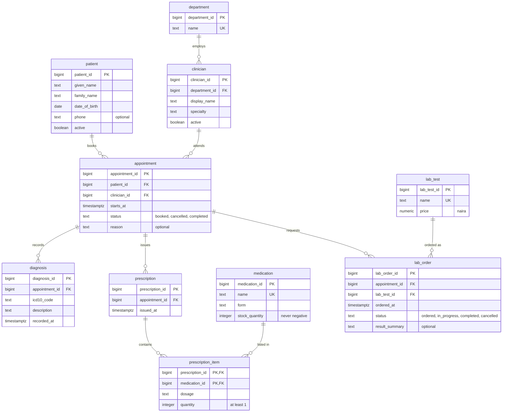
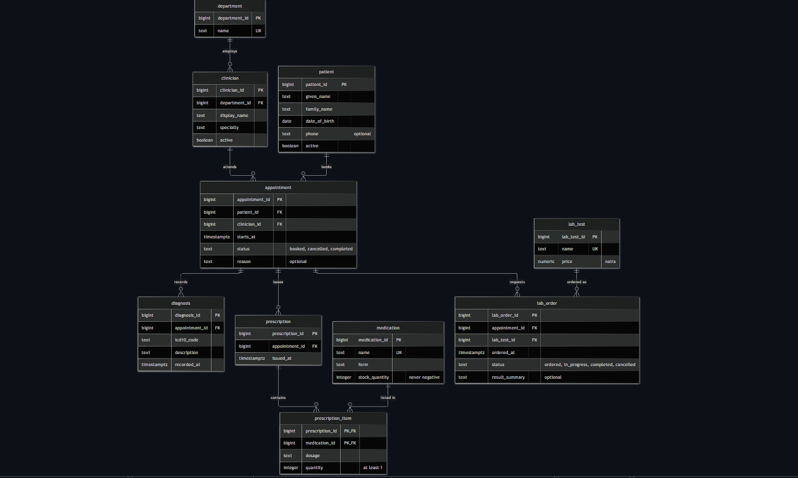

# The Craftsmen Clinic — ER diagram

**How to read it:** PK is a primary key, FK a foreign key and UK a unique value. `||--o{` means "exactly one on this side, zero or many on the other". For example, one department employs zero or many clinicians, and each clinician belongs to exactly one department.

prescription_item has a composite primary key (prescription_id, medication_id). It turns the many-to-many relationship between prescriptions and medications into two one-to-many relationships. lab_order does the same for appointments and lab tests.

The double-booking rule (one clinician, one start time) is a composite unique constraint on appointment and is listed in the design document.

