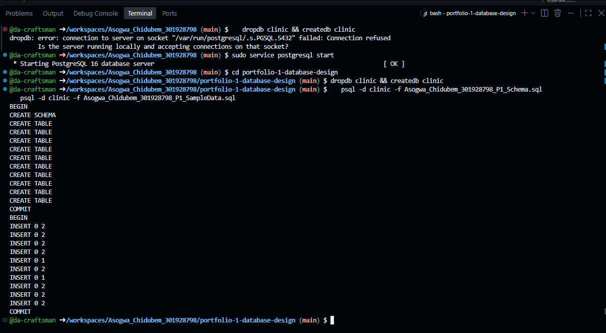
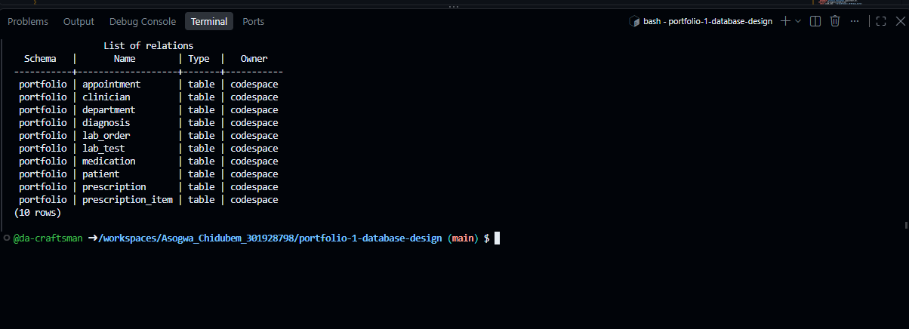

# Portfolio 1 — Database Design and Modelling

**Case study:** The Craftsmen Clinic, a fictional outpatient clinic with General Medicine and Dermatology units, a laboratory and a pharmacy.

## What I built

A PostgreSQL schema of ten tables covering patients, clinicians and departments, appointments, diagnoses, prescriptions and pharmacy stock, and laboratory orders. Business rules are enforced inside the database with primary keys, foreign keys, unique and check constraints, so invalid data is rejected no matter which application writes it.

| Document | Contents |
| --- | --- |
| [Design](Asogwa_Chidubem_301928798_P1_Design.md) | Case study, users, operations, relational schema, business rules, assumptions |
| [ER diagram](Asogwa_Chidubem_301928798_P1_ERDiagram.md) | Entities, attributes, keys and relationships |
| [Normalisation](Asogwa_Chidubem_301928798_P1_Normalisation.md) | A clinic visit form taken from UNF through 1NF, 2NF and 3NF |
| [Schema](Asogwa_Chidubem_301928798_P1_Schema.sql) | Tables and constraints |
| [Sample data](Asogwa_Chidubem_301928798_P1_SampleData.sql) | Fictional records for every table |
| [Constraint tests](Asogwa_Chidubem_301928798_P1_ConstraintTests.sql) | 12 deliberately invalid statements |
| [Join check](Asogwa_Chidubem_301928798_P1_JoinCheck.sql) | Proves the normalised tables rebuild the original data |

## How to run it

Tested on PostgreSQL 16 in GitHub Codespaces.

```bash
sudo service postgresql start
createdb clinic
psql -d clinic -f Asogwa_Chidubem_301928798_P1_Schema.sql
psql -d clinic -f Asogwa_Chidubem_301928798_P1_SampleData.sql
psql -d clinic -c "\dt portfolio.*"
psql -d clinic -e -f Asogwa_Chidubem_301928798_P1_ConstraintTests.sql
psql -d clinic -f Asogwa_Chidubem_301928798_P1_JoinCheck.sql
```

## Results

**Tables created:** all ten tables exist in the `portfolio` schema.



**Constraint tests:** all 12 invalid statements were rejected, each by the constraint it targets, and the sample data was unchanged. The tests cover duplicate keys, missing required values, references to records that don't exist, double booking a clinician, invalid statuses, a malformed ICD-10 code, negative pharmacy stock, a zero prescription quantity, the same medicine twice on one prescription, and deleting a patient who has appointment history.



**Normalisation check:** joining the final tables returns the same two rows as the 1NF table for appointment 6, so the decomposition lost no information.


## References

- PostgreSQL Global Development Group. *Constraints*. PostgreSQL 16 documentation. https://www.postgresql.org/docs/16/ddl-constraints.html
- PostgreSQL Global Development Group. *Foreign keys*. PostgreSQL 16 documentation. https://www.postgresql.org/docs/16/ddl-constraints.html#DDL-CONSTRAINTS-FK
- World Health Organization. *ICD-10 classification*. https://icd.who.int/browse10
- Mermaid. *Entity relationship diagrams*. https://mermaid.js.org/syntax/entityRelationshipDiagram.html
