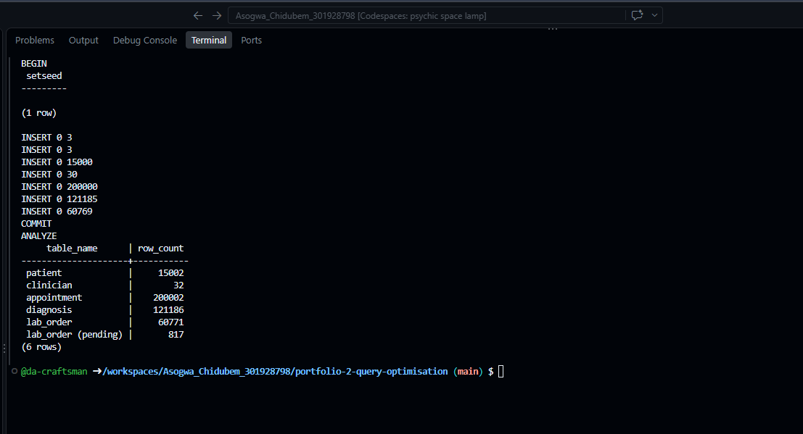
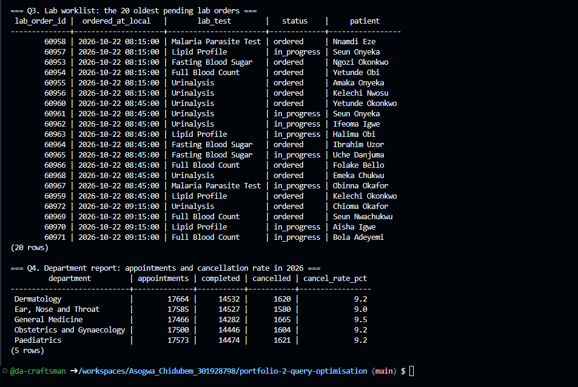
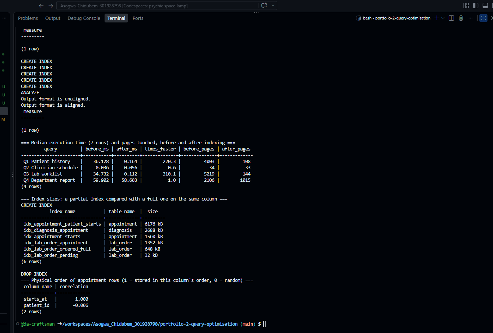
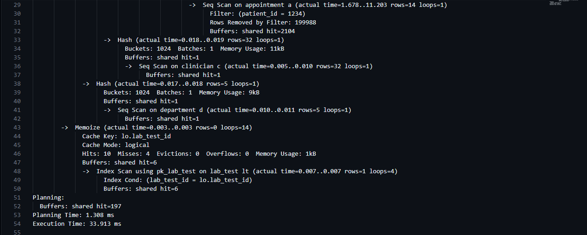
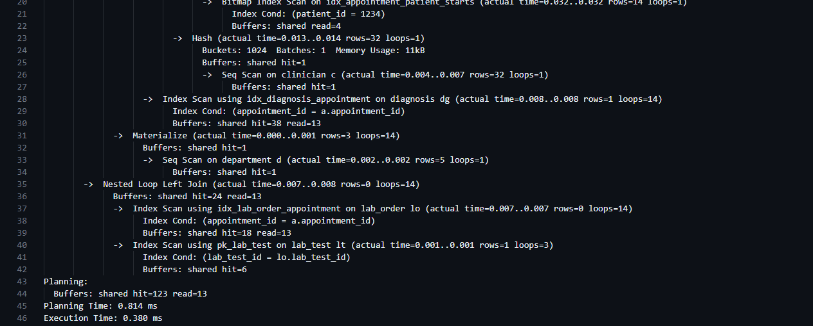

# Portfolio 2 — Query Processing and Optimisation

**Case study:** The Craftsmen Clinic (see Portfolio 1).

## What I did

I loaded the clinic database with two years of realistic activity, wrote four queries that clinic staff would run every day, and measured each one before and after adding indexes. The aim was not to index everything, but to find which indexes actually help, which don't, and what they cost.

| File | Purpose |
| --- | --- |
| [SeedData.sql](Asogwa_Chidubem_301928798_P2_SeedData.sql) | Generates 15,000 patients, 30 clinicians, 200,000 appointments, 121,186 diagnoses and 60,771 lab orders |
| [Queries.sql](Asogwa_Chidubem_301928798_P2_Queries.sql) | The four clinic queries and their results |
| [Benchmark.sql](Asogwa_Chidubem_301928798_P2_Benchmark.sql) | Saves execution plans and measures every query before and after indexing |
| [plans/](plans/) | The full execution plan of each query, before and after (8 files) |

## How to run it

Run after the Portfolio 1 schema and sample data, from this folder:

```bash
psql -d clinic -f Asogwa_Chidubem_301928798_P2_SeedData.sql   # once only
psql -d clinic -f Asogwa_Chidubem_301928798_P2_Queries.sql
psql -d clinic -f Asogwa_Chidubem_301928798_P2_Benchmark.sql  # safe to re-run
```

## The data



- The generator first lists every free 30-minute slot for each clinician on weekdays between 08:00 and 16:30, then picks 200,000 at random. Picking random times directly would eventually double-book a clinician, and the Portfolio 1 constraint `uq_appointment_clinician_slot` would reject the whole load. This is why there are 30 clinicians: 20 clinicians only have about 194,000 slots in two years.
- `setseed` fixes the random sequence, so anyone running the script gets identical data and comparable results.
- Only lab orders from the last ten days are pending (817 of 60,771), which reflects a lab that keeps up with its work.

## The queries

| Query | Who uses it | What it does |
| --- | --- | --- |
| Q1 Patient history | Clinician | Every visit for one patient, newest first, with clinician, department, diagnosis and lab test |
| Q2 Clinician schedule | Receptionist, clinician | One clinician's appointments on one day |
| Q3 Lab worklist | Lab scientist | The 20 oldest lab orders still pending |
| Q4 Department report | Administrator | Appointments, completions and cancellation rate per department for 2026 |




## Method

- Each query runs **7 times** with `EXPLAIN (ANALYZE, BUFFERS)` and the **median** execution time is recorded, so one unusually slow or fast run can't distort the result.
- I also record **pages touched**: the number of 8 kB data pages the query read. This doesn't depend on how busy the machine is, so it is a steadier measure than time.
- Parallel query is switched off so the before and after plans run on a single process and compare like for like.
- Every run starts by removing the Portfolio 2 indexes, so the "before" state is always the same.
- Environment: PostgreSQL 16 in a 2-core GitHub Codespace. All data fits in memory, so these are warm-cache timings.

## Results



| Query | Before (ms) | After (ms) | Faster | Pages before | Pages after |
| --- | --- | --- | --- | --- | --- |
| Q1 Patient history | 36.128 | 0.164 | 220× | 4,003 | 108 |
| Q2 Clinician schedule | 0.036 | 0.056 | no gain | 34 | 33 |
| Q3 Lab worklist | 34.732 | 0.112 | 310× | 5,219 | 144 |
| Q4 Department report | 59.902 | 58.603 | no gain | 2,106 | 1,015 |

## Analysis

### Q1 Patient history: 220× faster

**Before:** PostgreSQL read all 200,002 appointments to find the 14 belonging to patient 1234 (`Rows Removed by Filter: 199988`). It then read the whole diagnosis and lab order tables to match them up.



**Why:** PostgreSQL automatically indexes primary keys and unique constraints, but **not foreign key columns**. `appointment.patient_id`, `diagnosis.appointment_id` and `lab_order.appointment_id` had no index, so every lookup through them was a full scan.

**Indexes added:**

- `idx_appointment_patient_starts` on appointment (patient_id, starts_at DESC). Patient comes first because the query filters on it; start time second keeps each patient's visits in date order.
- `idx_diagnosis_appointment` and `idx_lab_order_appointment`, so each of the 14 visits finds its diagnosis and lab orders directly.

**After:** the plan uses a Bitmap Index Scan on `idx_appointment_patient_starts`, then index lookups into diagnosis and lab_order. Pages touched fell from 4,003 to 108.



This is the main cost of normalisation from Portfolio 1: a patient's history now lives across six tables and must be joined back together. Indexes on the join columns are what make that affordable.

### Q2 Clinician schedule: already fast

No index was added for Q2, and none was needed. The double-booking constraint from Portfolio 1, `uq_appointment_clinician_slot` on (clinician_id, starts_at), is enforced by a unique index. That index matches this query exactly: it filters on clinician and a range of start times. A business rule from the design stage turned out to be an optimisation as well.

The "after" time is slightly higher. After the Q4 index was added, the planner switched Q2 from the constraint's index to `idx_appointment_starts` (see `plans/Q2_clinician_schedule_after.txt`). Both are fast, and the difference of 0.02 ms is noise, but it shows that an index added for one query can change the plan of another.

### Q3 Lab worklist: 310× faster with a partial index

**Before:** PostgreSQL scanned all 60,771 lab orders, discarded 59,954 that were not pending, scanned the whole appointment table to join them, and sorted the result.

**Index added:** `idx_lab_order_pending` on lab_order (ordered_at) **WHERE status IN ('ordered', 'in_progress')**. This is a partial index: it only contains the 817 pending orders, already sorted by order time. The query reads the first 20 entries and stops.

| Index | Rows covered | Size |
| --- | --- | --- |
| Partial index (pending only) | 817 | 32 kB |
| Full index on the same column (comparison) | 60,771 | 648 kB |

The partial index is **20 times smaller** and serves this query just as well. As orders complete, they leave the index, so it stays small however large the table grows.

### Q4 Department report: indexing doesn't help

**Index tested:** `idx_appointment_starts` on appointment (starts_at).

The report covers all of 2026: 87,788 appointments, about 44% of the table. The planner did use the index, and pages touched halved, but the time barely changed. Two reasons:

1. **Most of the time is spent counting and grouping 87,788 rows**, not finding them. Reading the rows takes around 11–15 ms of the 59 ms; the index can only speed up that part.
2. **The index only works this well because of how the test data was loaded.** The correlation of starts_at is 1.000, meaning the rows are stored on disk in exactly date order, because the seed script inserted them that way. The index can then read one continuous block of the table. In a real clinic, appointments are booked days or weeks ahead, so rows are stored in booking order rather than appointment order. The correlation would be lower, and an index scan over 44% of the table would be slower than a plain sequential scan.

**Recommendation:** drop `idx_appointment_starts` in production. It costs 1,560 kB, slows every new booking slightly, gives no real gain, and changed Q2's plan for the worse. A report like this is better served by a summary table refreshed each night (for example a materialised view), so the counting is done once rather than every time someone opens the report.

## The cost of indexes

The indexes kept for Q1 and Q3 total about 10 MB. The largest, `idx_appointment_patient_starts`, is 6 MB on its own. Every index must also be updated on every insert, update and delete, so indexes trade write speed and storage for read speed. I did not measure write cost here; for this clinic, appointments are read far more often than they are created, so the trade is worth it for Q1 and Q3.

## Limitations

- All data fits in memory, so the timings show warm-cache performance. With a much larger database read from disk, the gap between scanning and indexing would be wider.
- Timings on a shared 2-core Codespace vary between runs. The medians and page counts are more reliable than any single number.
- The test data has no seasonal patterns or busy days, which a real clinic would have.

## References

- PostgreSQL Global Development Group. *Using EXPLAIN*. PostgreSQL 16 documentation. https://www.postgresql.org/docs/16/using-explain.html
- PostgreSQL Global Development Group. *Partial indexes*. PostgreSQL 16 documentation. https://www.postgresql.org/docs/16/indexes-partial.html
- PostgreSQL Global Development Group. *Multicolumn indexes*. PostgreSQL 16 documentation. https://www.postgresql.org/docs/16/indexes-multicolumn.html
- PostgreSQL Global Development Group. *Statistics used by the planner* (correlation). PostgreSQL 16 documentation. https://www.postgresql.org/docs/16/planner-stats.html
