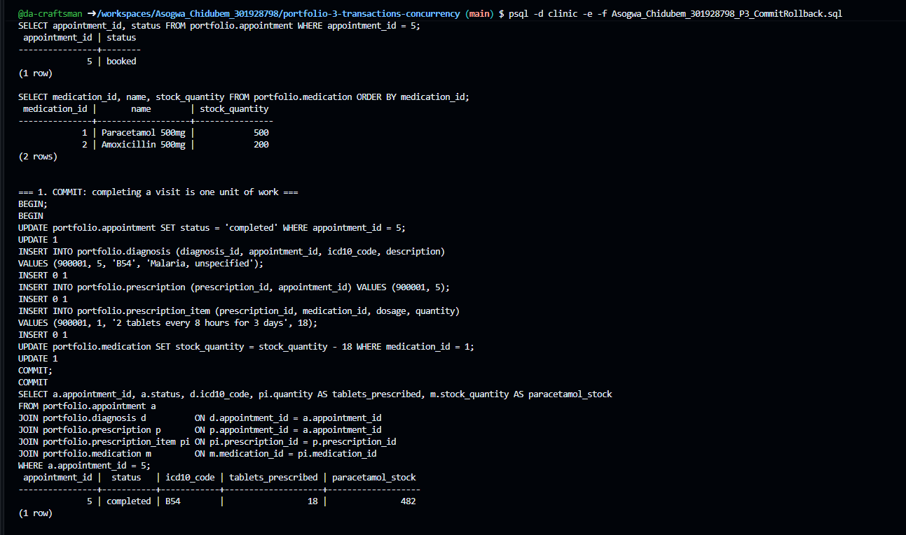
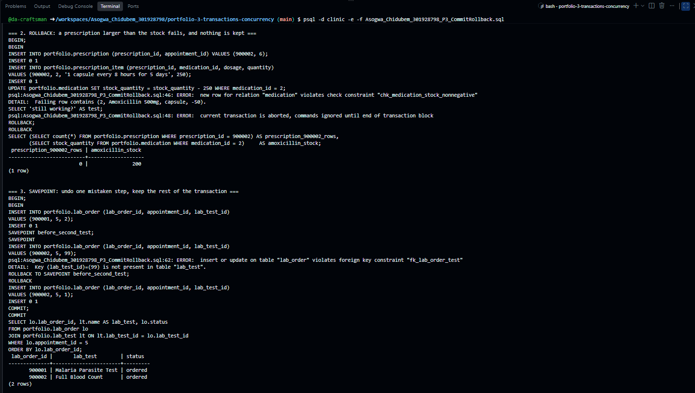
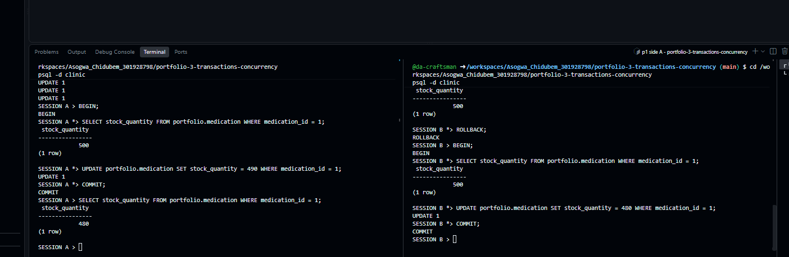
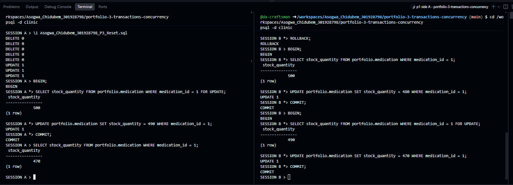
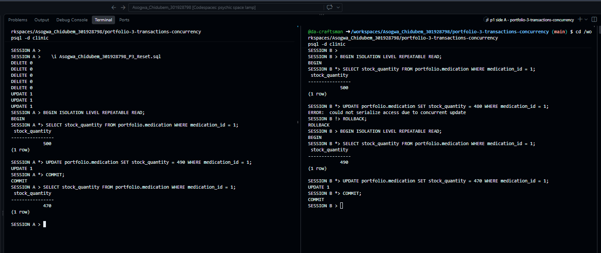
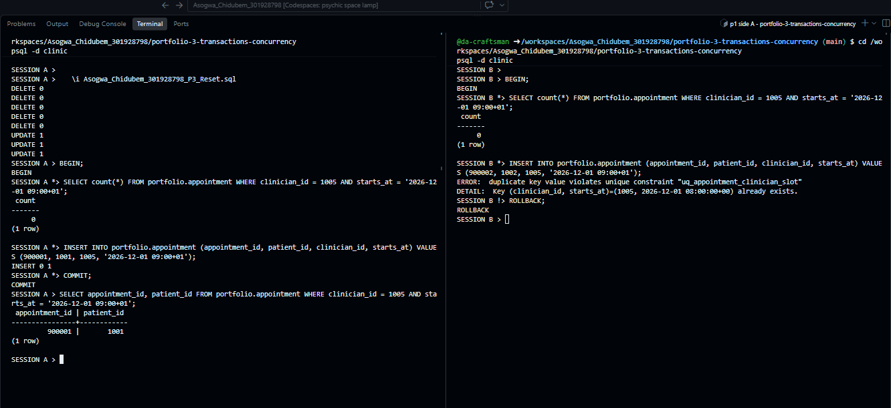
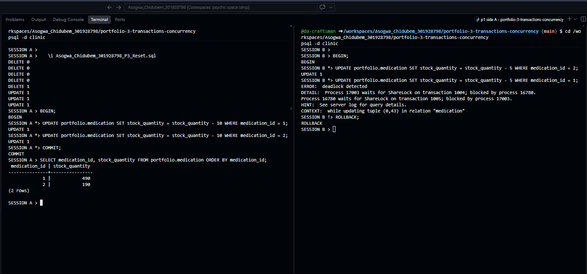

# Portfolio 3 — Transactions and Concurrency

**Case study:** The Craftsmen Clinic (see Portfolio 1).

## What I did

I used real clinic situations to show how PostgreSQL transactions keep data correct. A single-session script covers commit, rollback and savepoints. Five two-session scenarios, run in two psql terminals side by side, show what goes wrong when staff work at the same time and how the database prevents it.

| File | Purpose |
| --- | --- |
| [Reset.sql](Asogwa_Chidubem_301928798_P3_Reset.sql) | Returns the demo data to its starting state before each scenario |
| [CommitRollback.sql](Asogwa_Chidubem_301928798_P3_CommitRollback.sql) | Commit, automatic rollback and savepoint, in one session |
| [ConcurrencyScenarios.sql](Asogwa_Chidubem_301928798_P3_ConcurrencyScenarios.sql) | The step-by-step instructions for sessions A and B in each scenario |

All rows created here use IDs from 900000 upwards, so the reset script can remove them without touching the Portfolio 1 and 2 data. Medication stock starts at 500 Paracetamol tablets and 200 Amoxicillin capsules.

## How to run it

From this folder, after Portfolios 1 and 2:

```bash
psql -d clinic -e -f Asogwa_Chidubem_301928798_P3_CommitRollback.sql
```

For the scenarios, open two terminals, run `psql -d clinic` in each, and label them with `\set PROMPT1 'SESSION A %x> '` and `\set PROMPT1 'SESSION B %x> '`. The `*` that `%x` adds to the prompt shows when a session is inside a transaction. Run `\i Asogwa_Chidubem_301928798_P3_Reset.sql` in session A before each scenario, then follow the numbered steps in ConcurrencyScenarios.sql.

## Part 1 — Commit, rollback and savepoint

### Commit: completing a visit is one unit of work

When a clinician completes appointment 5, five changes must happen together: the status becomes completed, a diagnosis is recorded, a prescription is issued with its items, and 18 tablets leave pharmacy stock. They run inside one `BEGIN … COMMIT`. If any of them failed halfway, the clinic would have a completed visit with no prescription, or stock taken for a prescription that doesn't exist.

After the commit, appointment 5 is completed, diagnosis B54 is recorded, and Paracetamol stock is 482.



### Rollback: a failed step undoes the whole transaction

A prescription for 250 Amoxicillin capsules is entered, but only 200 are in stock. The prescription and its item insert successfully, then the stock update fails `chk_medication_stock_nonnegative`. Two things follow:

1. PostgreSQL refuses every further statement in that transaction (`current transaction is aborted, commands ignored until end of transaction block`) until it is rolled back.
2. After `ROLLBACK`, prescription 900002 has **0 rows**, even though its insert had succeeded, and stock is still 200.

This is **atomicity**: all of the transaction happens, or none of it. It also shows **consistency**: the check constraint from Portfolio 1 stopped the database reaching an invalid state, and the transaction made sure nothing partial was left behind.

### Savepoint: undo one step, keep the rest

While ordering two lab tests, the second is entered with a lab test ID that doesn't exist and fails its foreign key. `ROLLBACK TO SAVEPOINT` undoes only that step. The corrected test is then added and the transaction commits with both valid lab orders. Without the savepoint, the whole transaction, including the first valid order, would have had to be thrown away.



**Durability**, the last of the ACID properties, is why COMMIT matters: once PostgreSQL confirms a commit, the change is written to its write-ahead log and survives a crash or restart.

## Part 2 — Concurrency

PostgreSQL's default isolation level is **READ COMMITTED**: each statement sees only data that was committed before that statement began. That stops one session seeing another's unfinished work, but as Scenario 1 shows, it does not stop every problem on its own.

### Scenario 1 — Lost update

Two pharmacists dispense Paracetamol at the same time. Their application reads the stock, subtracts in its own code, and writes the new number back.

| Step | Session A (dispenses 10) | Session B (dispenses 20) |
| --- | --- | --- |
| 1–2 | BEGIN; reads stock: 500 | |
| 3–4 | | BEGIN; reads stock: 500 |
| 5–6 | writes 490; COMMIT | |
| 7–8 | | writes 480; COMMIT |
| 9 | reads stock: **480** | |

Thirty tablets were dispensed, so the stock should be 470. B calculated its new value from a reading that A's commit had made out of date, and its write replaced A's. Ten tablets disappeared from the records with **no error**, which is what makes lost updates dangerous: the pharmacy would only find out at the next physical stock count.



### Scenario 2 — Fix with a row lock: SELECT … FOR UPDATE

The same two pharmacists, but each reads the stock with `SELECT … FOR UPDATE`, which locks the row until their transaction ends.

| Step | Session A | Session B |
| --- | --- | --- |
| 1–2 | BEGIN; reads with FOR UPDATE: 500 (row locked) | |
| 3–4 | | BEGIN; reads with FOR UPDATE: **waits** |
| 5–6 | writes 490; COMMIT (lock released) | |
| | | the waiting read now returns **490** |
| 7–8 | | writes 470; COMMIT |
| 9 | reads stock: **470** | |

B's read returned 490, not 500. B had to wait for A's lock, so by the time it read the row, A's change was committed. This is **pessimistic locking**: assume a conflict will happen and make others wait. (The top of session B's pane in this screenshot still shows the end of Scenario 1; Scenario 2 starts at B's second `BEGIN`.)



### Scenario 3 — Fix with a stricter isolation level: REPEATABLE READ

Both sessions run at **REPEATABLE READ**, where a transaction works from a snapshot of the data taken at its first query.

| Step | Session A | Session B |
| --- | --- | --- |
| 1–2 | BEGIN REPEATABLE READ; reads 500 | |
| 3–4 | | BEGIN REPEATABLE READ; reads 500 |
| 5–6 | writes 490; COMMIT | |
| 7 | | writes 480: **ERROR: could not serialize access due to concurrent update** |
| 8 | | ROLLBACK |
| 9–12 | | retries: BEGIN; reads **490**; writes 470; COMMIT |
| 13 | reads stock: **470** | |

Nobody waited this time. Instead, PostgreSQL noticed that B was about to overwrite a row changed by a transaction B never saw, and refused. The application is expected to catch this error and retry the whole transaction, which then reads the up-to-date 490. This is **optimistic concurrency control**: assume conflicts are rare, detect them, and retry.



### Scenario 4 — Double booking

Two receptionists try to book Dr. 1005's 09:00 slot on 1 December 2026 for two different patients at the same moment. Each first checks that the slot is free.

| Step | Session A | Session B |
| --- | --- | --- |
| 1–2 | BEGIN; checks slot: 0 bookings (free) | |
| 3–4 | | BEGIN; checks slot: 0 bookings (free) |
| 5 | inserts booking for patient 1001 | |
| 6 | | inserts booking for patient 1002: **waits** |
| 7 | COMMIT | **ERROR: duplicate key value violates unique constraint "uq_appointment_clinician_slot"** |
| 8 | | ROLLBACK |
| 9 | the slot has exactly **one** booking | |

Both checks said the slot was free, because neither booking existed when they looked. A "check, then insert" rule written in application code would have let both through. What stopped it was the unique constraint from Portfolio 1: B's insert had to wait to see whether A's matching row would commit, and failed the moment it did. The rule enforced inside the database is the only one that holds when two people act at once.

The error shows the time as 08:00 +00: PostgreSQL displays timestamps in UTC, and 08:00 UTC is 09:00 in Lagos.



### Scenario 5 — Deadlock

Two pharmacists each dispense both medicines, but in opposite order.

| Step | Session A | Session B |
| --- | --- | --- |
| 1–2 | BEGIN; updates Paracetamol (locks it) | |
| 3–4 | | BEGIN; updates Amoxicillin (locks it) |
| 5 | updates Amoxicillin: **waits for B** | |
| 6 | | updates Paracetamol: **waits for A** |
| | after about one second: **ERROR: deadlock detected** in one session | |
| 7–8 | ROLLBACK in the cancelled session; COMMIT in the other | |

Each session held the lock the other needed, so neither could ever continue. PostgreSQL checks for this after `deadlock_timeout` (one second by default), cancels one of the transactions to break the cycle, and lets the other finish. The cancelled transaction's change is undone, so only one pharmacist's dispensing is recorded, and that pharmacist's application would need to retry.

The prevention is simple: always lock rows in the same order. If every transaction dispensed medicines in order of medication_id, the second pharmacist would wait at step 4 instead of creating a cycle.



## Comparing the control mechanisms

| Mechanism | How it works | Cost | Best for |
| --- | --- | --- | --- |
| `SELECT … FOR UPDATE` | Locks the row; others wait | Waiting; risk of deadlock if lock order differs | Busy rows where conflicts are likely, such as a popular medicine's stock |
| REPEATABLE READ | Detects the conflict; loser retries | The application must retry | Rare conflicts, where waiting would waste time |
| Unique constraint | Index rejects the second matching row | None beyond the index | Rules about uniqueness, such as one clinician per time slot |
| Relative update (`SET stock = stock - 18`) | The database calculates from the current value | None | Simple counters; used in Part 1 |

For the clinic, I would use relative updates with the stock check constraint for dispensing, the unique constraint for bookings, and a fixed lock order (by medication_id) whenever one transaction touches several medicines.

## References

- PostgreSQL Global Development Group. *Transactions*. PostgreSQL 16 documentation. https://www.postgresql.org/docs/16/tutorial-transactions.html
- PostgreSQL Global Development Group. *Transaction isolation*. PostgreSQL 16 documentation. https://www.postgresql.org/docs/16/transaction-iso.html
- PostgreSQL Global Development Group. *Explicit locking* (row-level locks and deadlocks). PostgreSQL 16 documentation. https://www.postgresql.org/docs/16/explicit-locking.html
- PostgreSQL Global Development Group. *SAVEPOINT*. PostgreSQL 16 documentation. https://www.postgresql.org/docs/16/sql-savepoint.html
