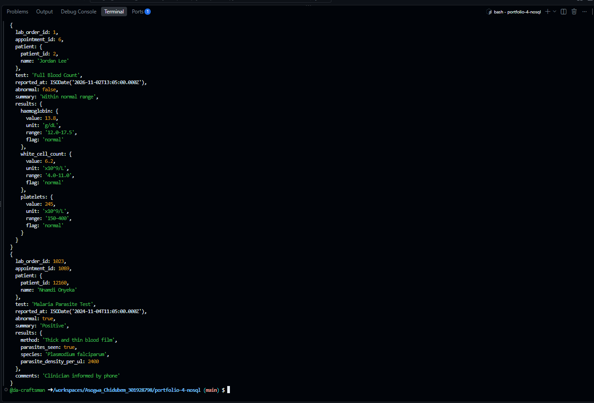
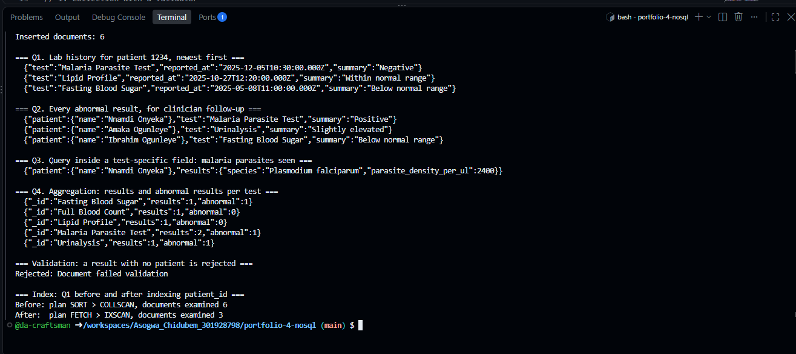

# Portfolio 4 — NoSQL and Advanced Data Models

**Case study:** The Craftsmen Clinic (see Portfolio 1).
**NoSQL model:** document database (MongoDB 7).

## What I did

In Portfolio 1, the `lab_order` table deliberately stores only a short result summary. The detailed results are different for every type of test, so I modelled them in MongoDB as documents, one document per completed lab order. Each document uses the same lab order, appointment and patient IDs as PostgreSQL, so the two databases describe the same clinic.

| File | Purpose |
| --- | --- |
| [LabResults.js](Asogwa_Chidubem_301928798_P4_LabResults.js) | Creates the collection with a validator, inserts six results, runs the queries, tests validation and indexing |

## How to run it

MongoDB runs in a Docker container inside the GitHub Codespace; mongosh is the MongoDB shell.

```bash
docker run -d --name mongo -p 27017:27017 mongo:7    # first time only; afterwards: docker start mongo
npm install -g mongosh                               # first time only
mongosh --quiet --file Asogwa_Chidubem_301928798_P4_LabResults.js
```

The script drops and rebuilds the collection, so it can be run any number of times.

## Why a document model suits lab results

Lab results have a **different structure for each test**:

| Test | What the result contains |
| --- | --- |
| Full Blood Count | Three measurements, each with a value, unit, reference range and flag |
| Malaria Parasite Test | A method, whether parasites were seen, and if so the species and density |
| Urinalysis | Mostly text values (trace, negative, 1+) and a list of microscopy findings |
| Fasting Blood Sugar | One measurement, plus how many hours the patient fasted |
| Lipid Profile | Four measurements |

Storing this in relational tables means choosing between three poor options:

1. **A table per test type.** Five tables today, and a new table plus a schema change every time the lab adds a test.
2. **One wide table** with a column for every possible measurement. Most columns would be empty in every row.
3. **One row per measurement** (lab_order_id, name, value, unit). Every value has to share one column type, so text results like "trace" and numbers like 13.8 get mixed; a malaria result's species no longer fits; and rebuilding one report needs many rows.

In MongoDB, each result is one document shaped like the test it describes. The two documents below sit in the same collection: a blood count with three measured values, and a positive malaria test with a species and parasite density.



A new test type needs no schema change; its documents simply have a new shape. And a report is read in one go, because everything about the result is in one document.

## Design decisions

**Flexible, but not unchecked.** A `$jsonSchema` validator requires the fields every result must have: lab_order_id, appointment_id, patient (with patient_id and name), test, reported_at, abnormal and results. It checks their types, but leaves the inside of `results` free to vary by test. Without it, a document with a missing patient would be saved silently.

**References to PostgreSQL.** lab_order_id, appointment_id and patient_id match the PostgreSQL rows. PostgreSQL remains the system of record for patients, appointments and lab orders; MongoDB holds the detailed results. Using two databases, each for the data it suits, is called **polyglot persistence**.

**The patient's name is embedded (denormalised).** Each document stores a copy of the patient's name, so a lab report can be produced without querying PostgreSQL. This breaks the "store each fact once" rule from Portfolio 1 on purpose. If a patient changes their name, older results keep the old one, which is acceptable for a lab report: it should show the name at the time it was issued. The patient_id remains the reliable link.

**A top-level `abnormal` flag.** Abnormal results are what clinicians need to follow up. Lifting this one yes/no out of the varying `results` lets one simple query find every abnormal result, whatever the test.

## Queries, validation and indexing



| Query | What it shows |
| --- | --- |
| Q1 Lab history for patient 1234 | Filtering on a field inside an embedded object (`patient.patient_id`) and sorting by date. Returns three results: malaria, lipid profile, fasting blood sugar |
| Q2 Every abnormal result | The top-level flag finds abnormal results across different test types: three of six |
| Q3 Malaria parasites seen | Querying a field that only exists in malaria documents (`results.parasites_seen`). Other documents simply don't match |
| Q4 Results per test | An aggregation pipeline that groups by test and counts total and abnormal results |

**Validation:** inserting a result with no patient fails with `Document failed validation`.

**Indexing:** before indexing, Q1's plan was `SORT > COLLSCAN`: MongoDB read all 6 documents, then sorted them. After creating an index on (patient.patient_id, reported_at descending), the plan became `FETCH > IXSCAN` and only the patient's 3 documents were examined, already in date order. It's the same principle as the composite index for patient history in Portfolio 2, applied to a document database.

## Where MongoDB would not be the right choice

The rest of the clinic stays in PostgreSQL. Appointments, prescriptions and stock depend on what Portfolios 1 and 3 showed: foreign keys between tables, check constraints, a unique constraint that prevents double booking, and transactions that update several tables together. A relational database does these naturally. MongoDB supports some of them, but they aren't what it is designed around.

It is also fair to say that PostgreSQL could store these results itself, in a JSONB column on lab_order. For a single small clinic, that would be a reasonable and simpler alternative. A separate document database becomes the better choice when the lab is its own system, when result volumes grow large, or when the results need to be spread across servers, which is the subject of Portfolio 5.

**Other NoSQL models, briefly.** A key-value store such as Redis would suit the clinic's live waiting-room queue: fast, short-lived data looked up by one key. A graph database such as Neo4j would suit a referral network between clinicians and hospitals, where the relationships themselves are what you query.

## References

- MongoDB, Inc. *Schema validation*. MongoDB Manual. https://www.mongodb.com/docs/manual/core/schema-validation/
- MongoDB, Inc. *Data modeling: embedded and referenced data*. MongoDB Manual. https://www.mongodb.com/docs/manual/data-modeling/
- MongoDB, Inc. *Aggregation pipeline*. MongoDB Manual. https://www.mongodb.com/docs/manual/core/aggregation-pipeline/
- MongoDB, Inc. *Explain results*. MongoDB Manual. https://www.mongodb.com/docs/manual/reference/explain-results/
- PostgreSQL Global Development Group. *JSON types*. PostgreSQL 16 documentation. https://www.postgresql.org/docs/16/datatype-json.html
