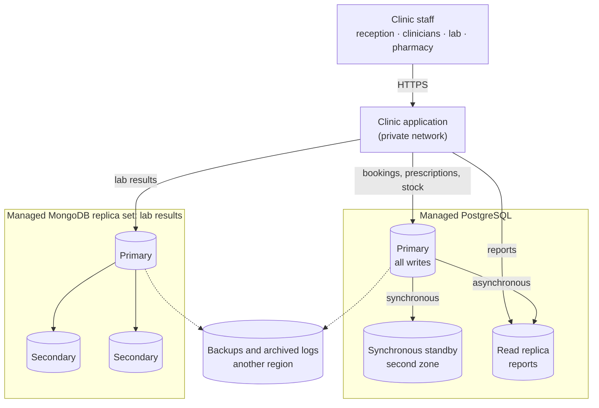

# Portfolio 5 — Distributed and Cloud Database Design

**Case study:** The Craftsmen Clinic (see Portfolio 1).

## What this covers

Portfolios 1 to 4 run on one PostgreSQL server and one MongoDB server inside a development environment. This portfolio discusses how The Craftsmen Clinic's databases would be distributed and deployed in the cloud: replication, sharding, availability, consistency and security. Every decision is based on the clinic's own data and on what the earlier portfolios showed.

## Starting assumptions

- The clinic today is one site. The plan should also hold if it grows into a small network of branches.
- Opening hours are 08:00 to 17:00 on weekdays. During those hours, an outage means staff cannot see patient history, book appointments or dispense medicine.
- Some data must never be wrong or lost: bookings, prescriptions, pharmacy stock and confirmed lab results. Other data can be a few seconds out of date: management reports and lab history views.

## 1. What has to be protected

| Data | Can it be slightly out of date? | Can a confirmed change be lost? | Why |
| --- | --- | --- | --- |
| Appointments | No | No | Double booking (Portfolio 3, Scenario 4) |
| Pharmacy stock | No | No | Lost updates (Portfolio 3, Scenarios 1–3) |
| Prescriptions and diagnoses | No | No | Clinical record |
| Lab results (MongoDB) | Yes, for viewing history | No | A confirmed result must survive any failure |
| Department reports (Portfolio 2, Q4) | Yes | — | Read-only summaries |

This table drives every choice below. The clinic needs strong consistency for its writes, and can accept slightly stale data only for reading reports and history.

## 2. Replication

Replication keeps copies of the same data on several servers, so the clinic keeps working if one server fails.

### PostgreSQL: one primary, two standbys

- **Primary:** the only server that accepts writes. All bookings, prescriptions and stock updates go here.
- **Synchronous standby, in a second data centre (availability zone).** A commit is only confirmed after the standby has also written it. If the primary fails, the standby takes over with **no confirmed data lost**. The cost is a few milliseconds extra on every commit, which a clinic will never notice.
- **Asynchronous read replica.** It receives changes a fraction of a second later. Management reports such as the department report (Portfolio 2, Q4) run here, so a heavy report never slows down a receptionist booking a patient.

**The read-after-write problem.** If a receptionist books an appointment and the next screen reads from the asynchronous replica, the new booking may not appear yet, and the receptionist might book again. So anything a member of staff has just changed is read from the primary. Only reports and history views use the replica.

### MongoDB: a three-member replica set

Lab results run as a replica set of three servers: one primary and two secondaries, each in a different availability zone. If the primary fails, the other two hold an **election** within seconds and one becomes the new primary.

- Results are written with **write concern `majority`**: the lab system is only told "saved" once at least two of the three servers have the result. A confirmed result cannot be lost when one server fails.
- Clinicians read with **read preference `primary`**, so they always see the latest results. Reports on results across the clinic can use `secondaryPreferred` and take load off the primary.

### Replication is not a backup

Replication copies **everything** within moments, including mistakes. If someone accidentally deletes a patient's prescriptions, the delete reaches every replica almost immediately. The clinic therefore also needs:

- Daily backups, kept for at least 30 days and stored in a different region.
- **Point-in-time recovery** for PostgreSQL. PostgreSQL writes every change to its write-ahead log before applying it; this is what made commits durable in Portfolio 3. Archiving that log allows the database to be restored to any moment, for example one minute before the accidental delete.

## 3. Sharding

Sharding splits data across servers, so each server holds only part of it. It is for data too large, or too busy, for one server.

### Does the clinic need it? Not now.

Portfolio 2 gives real numbers. Two years of activity at a 30-clinician clinic, 200,000 appointments, takes 35 MB including indexes. Even ten branches over ten years would be about 50 times that: under 2 GB. A single modern database server handles hundreds of gigabytes comfortably. Sharding would add complexity (routing queries, rebalancing data, queries that span shards) with no benefit, so **the clinic should not shard.** Replication, covered above, is what it needs.

### If it ever did: choosing a shard key

The decision that matters most in sharding is the **shard key**: the field that decides which server a document lives on. Suppose the lab grew into a national service storing millions of results. For the MongoDB `lab_results` collection:

| Candidate shard key | Verdict | Reason |
| --- | --- | --- |
| `test` | Bad | Only five values, so at most five useful shards, and the most common test overloads one of them |
| `reported_at` | Bad | Every new result has the newest date, so all writes land on the same shard (a "hot spot") |
| `patient.patient_id` (hashed) | **Good** | Thousands of values, so writes spread evenly; and a patient's whole history (Portfolio 4, Q1) lives on one shard, so it is still answered by a single server |

The good shard key is the same field as the index from Portfolio 4. A shard key should match how the data is read most often.

### PostgreSQL: partitioning before sharding

For PostgreSQL, the realistic next step before sharding is **partitioning**: splitting the appointment table into one partition per year on the same server. Old years can be archived cheaply, and a report on 2026 (Portfolio 2, Q4) only reads the 2026 partition. Portfolio 2 found that an index didn't help that report, because it reads 44% of the table; partitioning helps it by never touching the other years at all.

## 4. Consistency and availability: the CAP trade-off

The **CAP theorem** says that when the network between servers fails (a partition), a distributed database must choose between:

- **Consistency:** refusing requests it cannot answer correctly, or
- **Availability:** answering anyway, possibly with out-of-date data, or accepting writes that might conflict.

For the clinic, the choice differs by data:

- **Bookings, stock and prescriptions choose consistency.** If the primary cannot be reached, the system should refuse to book rather than risk two receptionists booking the same slot on two different servers. Portfolio 3 showed that the double-booking constraint works because **one primary checks every booking**. A design with several primaries accepting bookings independently would lose that guarantee. A few minutes of "cannot book, please try again" is far less harmful than two patients arriving for the same doctor at 09:00.
- **Viewing history and reports can choose availability.** If a replica is slightly behind, a clinician viewing last year's lab results is still well served.

The trade-off also exists when nothing is broken (the PACELC extension of CAP): synchronous replication makes every commit a little slower in exchange for never losing confirmed data. For clinical records, that exchange is worth making.

## 5. Availability targets

| Measure | Target | How it's met |
| --- | --- | --- |
| Recovery point objective (RPO): data that may be lost | **None** for confirmed clinical data | Synchronous standby (PostgreSQL); write concern majority (MongoDB) |
| Recovery time objective (RTO): time to recover | **Under 5 minutes** | Automatic failover to the standby; automatic MongoDB election |
| Recovery from mistakes | To any minute in the last 30 days | Backups and point-in-time recovery |

## 6. Cloud deployment

- **Managed services.** A managed PostgreSQL service (for example Amazon RDS with a Multi-AZ standby) and a managed MongoDB service (MongoDB Atlas) handle replication, failover, patching and backups. A small clinic has no database administrator, and these are exactly the tasks most likely to be neglected.
- **Region and data protection.** Patient data is sensitive personal data. Before choosing a region, the clinic would need to check Nigeria's Data Protection Act 2023, including its rules on transferring personal data outside the country. That could mean choosing a data centre in Nigeria, or confirming that a nearby cloud region (such as Cape Town) meets the Act's conditions for transfers.
- **Network access.** The databases accept connections only from the clinic application's private network, never from the open internet. Setting up MongoDB Atlas for this portfolio showed how easy the opposite is: the quickest setup option is "allow access from anywhere" (0.0.0.0/0), which is acceptable for fake data and unacceptable for a real clinic.
- **Least privilege.** Each part of the application connects with a database role that has only the access it needs. The reporting role can only read the replica; the lab system can write results but not prescriptions.
- **Encryption.** All connections use TLS; data and backups are encrypted at rest.

## Summary of decisions

| Topic | Decision |
| --- | --- |
| PostgreSQL replication | One primary, one synchronous standby in another zone, one asynchronous read replica for reports |
| MongoDB replication | Three-member replica set, write concern majority |
| Sharding | Not needed at the clinic's size; if ever needed, shard lab results on hashed patient_id |
| Large tables | Partition appointments by year before considering sharding |
| Consistency | Consistency first for bookings, stock and prescriptions; stale reads allowed only for reports and history |
| Recovery | No loss of confirmed data; failover in under 5 minutes; point-in-time recovery for mistakes |
| Deployment | Managed cloud services, private network, least-privilege roles, encryption, region chosen with the NDPA 2023 in mind |

## Limitations

This portfolio is a design discussion: the replication and failover described here were not deployed. Database sizes come from the Portfolio 2 test data, which is evenly spread and synthetic; a real clinic's growth would be uneven. Cloud services and regions are named as examples, not as a priced recommendation.

## References

- PostgreSQL Global Development Group. *High availability, load balancing, and replication*. PostgreSQL 16 documentation. https://www.postgresql.org/docs/16/high-availability.html
- PostgreSQL Global Development Group. *Continuous archiving and point-in-time recovery*. PostgreSQL 16 documentation. https://www.postgresql.org/docs/16/continuous-archiving.html
- PostgreSQL Global Development Group. *Table partitioning*. PostgreSQL 16 documentation. https://www.postgresql.org/docs/16/ddl-partitioning.html
- MongoDB, Inc. *Replication*. MongoDB Manual. https://www.mongodb.com/docs/manual/replication/
- MongoDB, Inc. *Write concern* and *Read preference*. MongoDB Manual. https://www.mongodb.com/docs/manual/reference/write-concern/
- MongoDB, Inc. *Choose a shard key*. MongoDB Manual. https://www.mongodb.com/docs/manual/core/sharding-choose-a-shard-key/
- Brewer, E. (2012). CAP twelve years later: How the "rules" have changed. *Computer*, 45(2), 23–29.
- Abadi, D. (2012). Consistency tradeoffs in modern distributed database system design. *Computer*, 45(2), 37–42.
- Federal Republic of Nigeria. *Nigeria Data Protection Act, 2023*.
